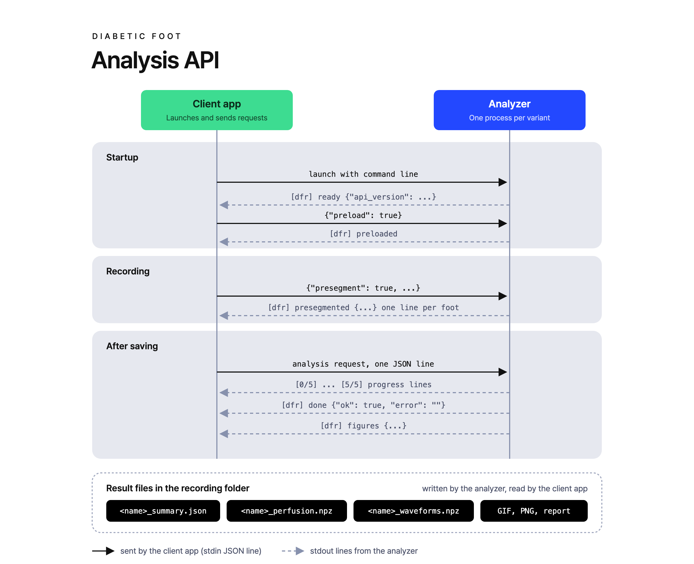

# diabetic-foot-api

당뇨발 촬영 앱(클라이언트 앱)과 관류 분석 프로그램이 주고받는 방식을 정하는 레포입니다.

## 개요

클라이언트 앱과 분석 프로그램은 서로의 코드를 모르고 이 레포의 API만 따르며, 두 쪽 모두 이 레포의 버전 태그 하나를 고정합니다.

- 분석 프로그램 교체: 분석 프로그램이 바뀌어도 API 버전이 같으면 클라이언트 앱은 그대로입니다.
- 클라이언트 앱 교체: 클라이언트 앱이 바뀌어도 분석 프로그램은 그대로입니다.



명령줄, 요청 줄, 출력 줄, 결과 파일, 오류의 규칙은 [`docs/analysis-api.md`](docs/analysis-api.md)를 참고하시기 바랍니다.

## 레포 구성

| 경로 | 내용 |
| --- | --- |
| `docs/analysis-api.md` | API 문서(규칙의 원본) |
| `API_VERSION` | 지금 API 버전(`1.0.0`) |
| `CHANGELOG.md` | 버전별 변경 |
| `schema/` | 요청 줄, `[dfr]` 줄, 요약, `VARIANT.json`의 JSON Schema(draft 2020-12) |
| `conformance/check_analyzer.py` | 분석 프로그램이 API를 지키는지 확인하는 도구 |
| `fake/fake_analyzer.py` | API대로 답하는 가짜 분석 프로그램 |

- 버전 값: 확인 도구와 가짜 분석 프로그램은 `API_VERSION`을 읽고, 분석 프로그램은 준비 줄과 요약에 같은 값을 `api_version`으로 씁니다.
- 실행 환경: 확인 도구와 가짜 분석 프로그램은 파이썬 3.9 이상의 표준 라이브러리만 쓰고, 이 레포의 폴더 구성 그대로 있어야 돕니다.

## 클라이언트 앱이 할 일

클라이언트 앱은 버전 태그를 고정하고, 시험에서는 실제 분석 프로그램 대신 가짜 분석 프로그램을 띄웁니다.

1. 이 레포를 버전 태그(예: `v1.0.0`)로 가져옵니다. git submodule이나 태그의 소스 묶음을 씁니다.
2. 분석 프로그램을 `docs/analysis-api.md` 2절의 명령줄로 띄우고, 준비 줄의 `api_version` 주 버전을 고정한 버전과 견줍니다.
3. 시험에서는 가짜 분석 프로그램을 띄웁니다.

```bash
python fake/fake_analyzer.py --idle-exit 0 --presegment-threads 2 --prestream --variant fake
```

분석 프로그램 폴더는 `fake/`이고 판은 `fake` 하나입니다. 가짜 분석 프로그램은 받은 줄마다 `schema/request.schema.json`으로 확인하고, 어긴 줄을 받으면 어긴 키를 적은 실패 완료 줄을 찍고 종료 코드 4로 끝납니다. 그래서 클라이언트 앱의 시험은 API를 어긴 요청을 보내면 실패합니다.

- 결과: 모든 요청에 같은 고정 값입니다. 시간 창 11개, 영상 900장 30 fps, 왼발 PI 0.12%, 오른발 PI 0.15%이고, 커프 단계는 `classify`가 true일 때 0(정상)입니다. 결과 파일 일곱 개(요약, npz 두 개, PNG 세 장, `gif`가 true이면 GIF)를 씁니다.
- 실패 흉내: 요청의 `name`이 `fail`이면 두 줄짜리 오류가 든 실패 완료 줄, `hang`이면 `[1/5]` 뒤 60초 동안 출력 없음, `crash`이면 `[1/5]` 뒤 종료 코드 3, `nosummary`이면 결과 파일 없는 성공 완료 줄을 냅니다.
- 단계 사이 대기: `--stage-ms`나 환경 변수 `FAKE_ANALYSIS_STAGE_MS`로 정하고, 기본 200밀리초입니다.
- 영상 파일: 있어야 하지만 내용은 읽지 않습니다. 그래서 영상 머리글의 장 수 확인, 가로로 긴 영상 거절, 발을 찾지 못한 경우는 흉내 내지 않습니다.
- `--no-client-check`: 실제 분석 프로그램처럼 실패 완료 줄로 답하고 다음 요청을 받습니다. 확인 도구의 자체 시험이 이 인자를 씁니다.

## 분석 프로그램이 할 일

분석 프로그램은 자기 CI에서 고정한 태그의 확인 도구를 돌려 API를 지킨다는 것을 보입니다. 확인 도구는 촬영 폴더 하나로 분석 요청 두 건을 보내고, 촬영 폴더에는 아무것도 쓰지 않습니다.

```yaml
- uses: actions/checkout@v4
  with:
    repository: deep-medi-Research/diabetic-foot-api
    ref: v1.0.0
    path: api
- run: >
    python api/conformance/check_analyzer.py
    --analyzer "python <진입 스크립트>"
    --analyzer-dir <분석 프로그램 폴더>
    --variant <판>
    --recording <촬영 폴더>
```

- `--analyzer`: 명령은 `--analyzer-dir`을 작업 폴더로 삼아 돕니다. 명령 안의 상대 경로는 분석 프로그램 폴더 기준이고, 첫 인자가 지금 폴더 기준으로 있는 파일이면 절대 경로로 바꿉니다.
- `--recording`: 폴더에 `*_shot.json`이 있으면 그 `files.left_video`, `files.right_video`와 사이드카의 `frames.written`으로 요청을 만듭니다. 없으면 영상 경로 없이 보내고, 분석 프로그램은 `left.avi`, `right.avi`를 씁니다.
- 결과: 어긴 규칙마다 한 줄을 찍고, 하나라도 있으면 종료 코드 1로 끝납니다. `--work <폴더>`를 주면 결과 파일을 그 폴더에 남깁니다.
- `--self-test`: 가짜 분석 프로그램으로 이 도구를 확인합니다. 가짜 분석 프로그램의 통과, `worker_version`을 뺀 가짜 분석 프로그램에서 위반 찾기, 가짜 분석 프로그램의 요청 확인을 봅니다. 이 레포의 CI가 Ubuntu와 Windows, 파이썬 3.9와 최신판에서 돌립니다.

## 버전 규칙

API 버전은 `MAJOR.MINOR.PATCH`이고, `API_VERSION` 파일과 git 태그 `v<버전>`이 같습니다. 자세한 기준은 `docs/analysis-api.md` 10절에 있습니다.

| 변경 | 올리는 자리 |
| --- | --- |
| 옛 버전을 따르는 쪽이 깨짐 | MAJOR |
| 선택 키, 줄 종류, 이유 코드 더하기 | MINOR |
| 뜻이 같은 문서 고침 | PATCH |

- 변경 기록: 버전별 변경은 [`CHANGELOG.md`](CHANGELOG.md)에 있고 형식은 Keep a Changelog 1.1.0입니다. 태그를 달 때 `[Unreleased]`를 그 버전의 절로 바꿉니다.
- 올리지 않는 변경: README, 그림, CI만 바꾸면 버전을 올리지 않습니다.
- 태그: 한 번 단 태그는 옮기지 않습니다. 클라이언트 앱과 분석 프로그램이 태그를 고정하므로, 고칠 것이 생기면 새 버전으로 태그를 답니다.

## 그림 원본

그림 원본은 `docs/images/flow.html`이며, Chrome에서 1280x1040, 배율 2로 캡처합니다.

## 라이선스

이 레포의 코드와 문서는 저작권이 딥메디에 있고, 사용, 복제, 수정, 배포를 허락하는 라이선스를 두지 않습니다(All rights reserved). 협력사와 함께 개발하려고 공개해 두었으며, 공개되어 있다고 해서 사용을 허락한다는 뜻은 아닙니다. 이 코드를 쓰려면 딥메디와 따로 합의해야 합니다.
