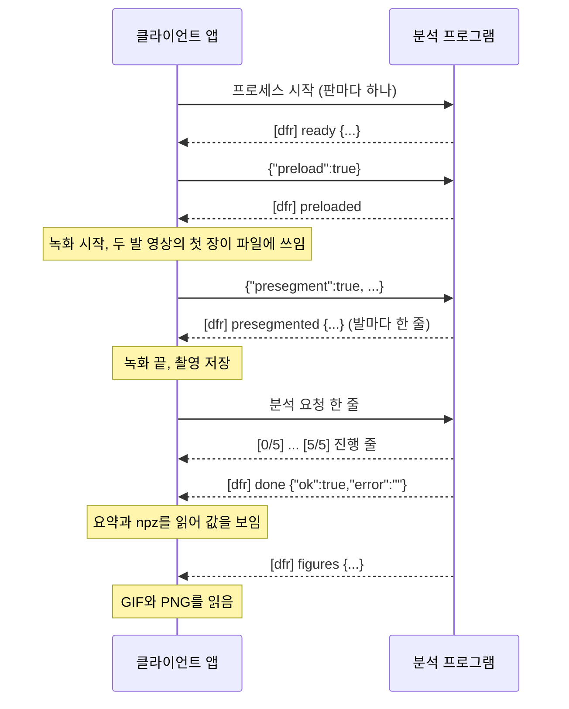

# 관류 분석 API

API 버전 1.0.0(`API_VERSION` 파일)

<mark>**클라이언트 앱과 분석 프로그램은 서로의 코드를 모르고, 이 문서가 정한 명령줄, 표준 입력의 JSON 한 줄, 표준 출력의 줄, 결과 파일로만 주고받습니다.**</mark> 이 문서가 규칙의 원본입니다. `schema/`의 JSON Schema와 `conformance/check_analyzer.py`가 같은 규칙을 프로그램으로 확인하고, 두 쪽은 이 저장소의 버전 태그 하나를 고정해 따릅니다.

- **클라이언트 앱은 분석 프로그램을 띄우고 요청을 보내는 쪽입니다**<br>지금은 당뇨발 촬영 앱이 클라이언트 앱입니다. 다른 앱도 이 문서만 따르면 같은 분석 프로그램을 씁니다
- **분석 프로그램은 요청을 받아 분석하고 결과 파일을 쓰는 프로세스입니다**<br>분석 판(variant)마다 프로세스를 하나씩 띄웁니다
- **좌우(왼발, 오른발, `left`, `right`)는 모두 피험자 기준입니다**
- **이 문서가 적은 분석 프로그램의 동작은 분석 프로그램의 의무입니다**<br>확인 도구가 분석 프로그램의 의무를 확인하고, 가짜 분석 프로그램(`fake/fake_analyzer.py`)이 클라이언트 앱의 요청 줄을 확인합니다

## 1. 흐름

클라이언트 앱은 분석 프로그램을 미리 띄워 두고, 촬영을 저장할 때마다 분석 요청을 한 줄 보냅니다.



- **분석 프로그램은 요청을 받은 순서대로 한 건씩 처리합니다**<br>분석 중에는 표준 입력을 읽지 않고, 분석 중에 도착한 줄은 그 분석의 완료 줄을 찍은 뒤 읽습니다
- **클라이언트 앱은 분석 요청의 완료 줄을 받은 뒤에 다음 분석 요청을 보냅니다**<br>대기열은 클라이언트 앱에 있습니다. 앞 분석의 그림을 그리는 중에 받은 분석 요청은 그림을 다 그린 뒤 시작합니다
- **preload와 분석은 모델 파일과 영상을 디스크에서 읽습니다**<br>녹화하는 PC의 클라이언트 앱은 녹화 중에 이 두 요청을 보내지 않고, presegment 요청만 보냅니다

## 2. 분석 프로그램 폴더와 띄우기

분석 프로그램은 폴더 하나로 배포됩니다.

```text
<분석 프로그램 폴더>/
  <진입 스크립트와 그 밖의 파일>    분석 프로그램이 정합니다
  variants/<판>/VARIANT.json      판 정보
```

클라이언트 앱은 다음 명령줄로 판마다 분석 프로그램을 하나씩 띄우고, 클라이언트 앱이 닫힐 때까지 둡니다.

```text
<분석 프로그램 명령> --idle-exit 0 --presegment-threads 2 --prestream --variant <판>
```

| 인자 | 클라이언트 앱의 값 | 필수 |
| --- | --- | --- |
| `--variant <판>` | 판 이름 | 예 |
| `--idle-exit <초>` | `0` | 아니오 |
| `--presegment-threads <수>` | `2` | 아니오 |
| `--prestream` | 값 없음 | 아니오 |

- **분석 프로그램 명령은 설치 구성이 정합니다**<br>파이썬 실행 파일과 진입 스크립트처럼 실행 파일 하나와 앞 인자 목록입니다. 이 API는 진입 스크립트의 이름을 정하지 않으므로, 클라이언트 앱은 명령과 분석 프로그램 폴더를 설정으로 받습니다
- **작업 폴더는 분석 프로그램 폴더입니다**<br>명령 안의 상대 경로는 이 폴더 기준입니다
- **클라이언트 앱은 환경 변수 `PYTHONUNBUFFERED=1`, `PYTHONUTF8=1`, `PYTHONIOENCODING=utf-8`을 더해 띄웁니다**<br>Windows에서 파이썬 분석 프로그램이 표준 입력을 UTF-8로 읽게 하는 값입니다
- **클라이언트 앱은 표준 오류를 표준 출력과 합쳐 한 스트림으로 읽습니다**
- **`--variant`가 없거나 `variants/`에 없는 판이면 분석 프로그램은 준비 줄을 찍지 않고 0이 아닌 종료 코드로 끝납니다**
- **`--idle-exit`가 0보다 크면 요청 없이 그 시간(초)이 지난 뒤 `[dfr] idle-exit`을 찍고 종료 코드 0으로 끝납니다**<br>분석 중에는 시간을 세지 않습니다. 0 이하이면 스스로 끝나지 않고, 인자를 빼면 600초입니다. 클라이언트 앱은 촬영마다 모델을 다시 올리지 않도록 0을 줍니다
- **`--presegment-threads`와 `--prestream`은 녹화 중 미리 계산을 켭니다**<br>`--presegment-threads <수>`는 녹화 중 첫 장 미리 분할과 그 스레드 수이고, `--prestream`은 녹화 중 영상 미리 읽기입니다. `--prestream`만 주면 미리 분할도 2 스레드로 켭니다. 클라이언트 앱은 둘을 빼고 띄워도 됩니다. 결과 값은 미리 계산을 켜든 끄든 같고, 발 분할의 검출 상자와 점수만 스레드 수에 따라 1e-5 정도 다를 수 있습니다
- **표준 입력이 닫히면 분석 프로그램은 종료 코드 0으로 끝납니다**<br>클라이언트 앱은 표준 입력을 닫고 3초를 기다린 뒤 강제 종료할 수 있습니다

### 2.1 판 찾기

클라이언트 앱은 `<분석 프로그램 폴더>/variants/*/VARIANT.json`을 읽어 판을 찾고, `id`가 폴더 이름과 같은 것만 판으로 봅니다. 스키마는 `schema/variant.schema.json`입니다.

| 키 | 형식 | 필수 |
| --- | --- | --- |
| `id` | 문자열 | 예 |
| `label` | 문자열 | 아니오 |
| `summary` | 문자열 | 아니오 |
| `upstream.commit`, `upstream.date` | 문자열 | 아니오 |
| `release` | 객체 | 아니오 |

- **`id`는 폴더 이름과 같고 `--variant`의 값입니다**
- **`label`은 판을 보이는 이름이고, 없으면 `id`를 씁니다**<br>`summary`는 판 설명 한 줄입니다
- **`upstream`과 `release`는 판의 출처 표시입니다**<br>`release`의 내용은 분석 프로그램이 정하고, 클라이언트 앱은 보이기만 합니다

## 3. 줄 형식

- **표준 입력과 표준 출력은 BOM 없는 UTF-8이고, 한 줄에 메시지 하나입니다**
- **클라이언트 앱이 쓰는 줄은 `\n`으로 끝납니다**<br>한글 경로는 이스케이프하지 않고 UTF-8 그대로 써도 됩니다. JSON 이스케이프는 `"`, `\`, 제어 문자만 하면 됩니다
- **분석 프로그램의 줄은 `\n` 또는 `\r\n`으로 끝납니다**<br>클라이언트 앱은 줄 끝의 `\r`을 뗍니다
- **분석 프로그램은 빈 요청 줄을 건너뜁니다**
- **BOM으로 시작하는 요청 줄은 JSON으로 읽지 못하는 줄입니다**<br>분석 프로그램은 실패 완료 줄로 답합니다

## 4. 클라이언트 앱이 보내는 줄

세 종류 모두 `schema/request.schema.json` 하나로 확인합니다.

| 줄 | 보내는 때 | 답 |
| --- | --- | --- |
| `{"preload":true}` | 준비 줄을 받은 뒤 한 번 | `preloaded` 또는 `preload-failed` |
| `{"presegment":true,"left_video":...,"right_video":...}` | 녹화 중 첫 장이 파일에 쓰였을 때 | 발마다 `presegmented` |
| 분석 요청 | 촬영을 저장한 뒤 | 진행 줄, `done` |

- **분석 프로그램은 `presegment`가 true이면 미리 분할 요청, 아니고 `preload`가 true이면 preload, 둘 다 아니면 분석 요청으로 읽습니다**
- **preload는 보내지 않아도 됩니다**<br>분석 요청이 모델을 올립니다. `preload-failed`를 받은 뒤에도 분석 요청을 보내면 분석이 모델을 다시 올립니다
- **presegment 요청은 preload의 답을 받은 뒤에 보냅니다**<br>클라이언트 앱은 답을 기다리지 않습니다. 완료 줄은 오지 않고, 분석 프로그램은 미리 분할을 뒤에서 하며 다음 요청을 바로 읽습니다. 분석 프로그램을 미리 계산 없이 띄웠거나 모델이 아직 없으면 `video` 없는 실패 `presegmented` 줄 하나를 찍습니다
- **`--prestream`으로 띄웠으면 같은 presegment 요청으로 녹화 중 미리 읽기도 시작합니다**<br>발마다 `prestreamed` 줄을 찍습니다

### 4.1 분석 요청

요청 한 줄의 예입니다. 읽기 쉽게 줄을 나눴지만 실제로는 한 줄입니다.

```json
{"rec_dir":"D:/DiabeticFoot/홍길동_19551103/A/102528",
 "left_video":"D:/DiabeticFoot/홍길동_19551103/A/102528/102528_left.mkv",
 "right_video":"D:/DiabeticFoot/홍길동_19551103/A/102528/102528_right.mkv",
 "left_frames":900,"right_frames":900,
 "output":"D:/DiabeticFoot/홍길동_19551103/A/102528/perfusion/v11",
 "name":"102528","cuff_side":"none","template":"v106w",
 "classify":true,"pad_classifier":false,"gif":true,"defer_figures":true}
```

| 키 | 형식 | 기본값 | 필수 |
| --- | --- | --- | --- |
| `rec_dir` | 문자열 | 없음 | 예 |
| `output` | 문자열 | 없음 | 예 |
| `left_video`, `right_video` | 문자열 | `left.avi`, `right.avi` | 둘 다 주거나 둘 다 뺌 |
| `left_frames`, `right_frames` | 정수 | 없음 | 아니오 |
| `name` | 문자열 | 아래 설명 | 아니오 |
| `cuff_side` | `left`, `right`, `none` | 아래 설명 | 아니오 |
| `template` | `v106w`, `pos` | `v106w` | 아니오 |
| `classify` | 참거짓 | false | 아니오 |
| `pad_classifier` | 참거짓 | false | 아니오 |
| `gif` | 참거짓 | false | 아니오 |
| `defer_figures` | 참거짓 | false | 아니오 |

- **`rec_dir`는 촬영 폴더입니다**<br>분석 프로그램은 이 폴더의 녹화 기록 파일도 읽습니다(8절)
- **`output`은 결과 폴더입니다**<br>없으면 분석 프로그램이 만듭니다. 지금 클라이언트 앱은 `<rec_dir>/perfusion/<판>`을 줍니다
- **영상 경로를 빼면 분석 프로그램은 `rec_dir`의 `left.avi`, `right.avi`를 씁니다**<br>한쪽만 주면 거절합니다
- **장 수를 주면 분석 프로그램이 영상 머리글의 장 수와 견줍니다**<br>다르면 분석하지 않고 실패로 답합니다
- **`name`은 결과 파일 이름의 앞부분입니다**<br>없거나 비면 `<rec_dir의 부모 폴더 이름>_<rec_dir 폴더 이름>`입니다. 클라이언트 앱은 요약 경로를 `<output>/<name>_summary.json`으로 정하므로 `name`을 늘 줍니다
- **`cuff_side`는 커프를 감은 발입니다**<br>요약의 `cuff_side`, `pi_ratio_cuffed_other`와 그림의 발 이름표에만 쓰이고 커프 단계 판정에는 쓰이지 않습니다. 없거나 비면 판의 연구 기록에 그 촬영이 있을 때 그 값이고, 없으면 `left`입니다
- **`template`이 `pos`이면 맥박 템플릿으로 POS를 쓰고 커프 단계는 null입니다**
- **`classify`가 true일 때만 커프 단계를 냅니다**<br>그래도 null이 되는 조건은 7.2.1절에 있습니다
- **`pad_classifier`가 true이면 분석하지 않고 실패로 답합니다**<br>이진 PAD 판정 모델은 배포 패키지에 없습니다
- **`gif`가 true이면 관류 지도 GIF를 씁니다**<br>PNG는 `gif`와 관계없이 그립니다
- **`defer_figures`가 true이면 그림을 완료 줄 뒤에 그립니다**<br>요약과 npz 두 개를 쓴 뒤 `[dfr] done`을 찍고, 그림을 다 그리면 `[dfr] figures`를 찍습니다. false이면 그림까지 그린 뒤 `[dfr] done`을 찍고 figures 줄은 없습니다. 실패한 분석은 그림을 그리지 않고 figures 줄도 없습니다
- **분석 프로그램은 모르는 키를 무시합니다**

## 5. 분석 프로그램이 내는 줄

클라이언트 앱은 `[dfr] `로 시작하는 줄과 진행 줄만 해석하고, 나머지 줄은 기록만 합니다.

| 줄 | 찍는 때 | 스키마 |
| --- | --- | --- |
| `[dfr] ready {JSON}` | 요청을 받을 준비가 됨 | `ready.schema.json` |
| `[dfr] preloaded` | 모델을 올림 | 없음 |
| `[dfr] preload-failed <이유>` | 모델을 올리지 못함 | 없음 |
| `[n/m] <문구>` | 진행 단계 시작 | 없음 |
| `  [k/n] <문구>` | 하위 단계 시작 | 없음 |
| `[dfr] done {JSON}` | 요청 한 건이 끝남 | `done.schema.json` |
| `[dfr] figures {JSON}` | 미룬 그림을 다 그림 | `figures.schema.json` |
| `[dfr] presegmented {JSON}` | 첫 장 미리 분할이 끝남 | `presegmented.schema.json` |
| `[dfr] prestreamed {JSON}` | 녹화 중 미리 읽기가 끝남 | `prestreamed.schema.json` |
| `[dfr] stamp-failed <이유>` | 요약을 바꿔 쓰지 못함 | 없음 |
| `[dfr] idle-exit` | 요청 없이 시간이 지나 끝남 | 없음 |
| 그 밖의 줄 | 분석 코드의 글, 예외 기록 | 없음 |

- **`[dfr]` 줄은 `[dfr] <종류>`이고, 내용이 있으면 종류 뒤에 공백 하나와 내용이 옵니다**<br>JSON 내용은 객체 하나이고 `NaN`, `Infinity`를 쓰지 않습니다. 내용이 없는 종류는 종류 이름에서 줄이 끝납니다
- **클라이언트 앱은 모르는 종류의 `[dfr]` 줄을 기록만 합니다**

### 5.1 준비 줄

| 키 | 형식 | 뜻 |
| --- | --- | --- |
| `api_version` | 문자열 | 따르는 API 버전 |
| `worker_version` | 문자열 | 분석 프로그램 빌드 |
| `variant` | 문자열 | 올린 판 |
| `upstream_commit` | 문자열, null | 판의 연구 코드 커밋 |

- **네 키 모두 필수입니다**
- **`api_version`은 분석 프로그램이 따르는 이 API의 버전입니다**<br>`API_VERSION` 파일과 같은 형식(`1.0.0`)입니다. 분석 패키지의 매니페스트도 같은 값을 같은 키 이름 `api_version`으로 적습니다. 클라이언트 앱은 주 버전이 자기가 고정한 버전과 다르면 그 분석 프로그램을 쓰지 않습니다
- **`worker_version`은 분석 프로그램의 코드와 모델을 가리키는 비어 있지 않은 문자열입니다**<br>예를 들면 분석 프로그램의 릴리즈 태그나 커밋입니다. 같은 문자열이면 같은 코드와 모델입니다. 클라이언트 앱은 이 값으로 결과를 낸 분석 프로그램을 기록합니다
- **요약의 `dfr`에도 같은 `api_version`, `worker_version`, `variant`, `upstream_commit`을 씁니다**<br>클라이언트 앱은 결과 파일만 남은 뒤에도 결과를 낸 분석 프로그램을 요약에서 읽습니다

### 5.2 진행 줄

- **진행 줄은 0번째 칸에서 시작하는 `[n/m]`입니다**<br>n과 m은 1~6자리 숫자이고 m > 0, n ≤ m입니다. 앞에 공백이 있으면 하위 단계입니다. 줄 끝의 공백과 괄호 안 경과 시간(`[12 s]`, `(0 s)`)은 문구가 아닙니다
- **분석 프로그램은 분석 중에 진행 줄 사이를 180초 넘게 비우지 않습니다**<br>하위 단계 줄도 진행 줄로 셉니다
- **m이 5이면 단계 번호의 뜻은 아래 표와 같습니다**<br>지금 분석 프로그램은 `[0/5]`부터 `[5/5]`까지 여섯 줄을 찍고 하위 단계 줄은 찍지 않습니다. m이 5가 아니면 클라이언트 앱은 문구를 그대로 보입니다

| 번호 | 단계 |
| --- | --- |
| 0 | 분석 모델 준비 |
| 1 | 영상 읽기와 발 찾기 |
| 2 | 맥박 신호 추출 |
| 3 | 관류 계산 |
| 4 | 커프 단계 추정 |
| 5 | 결과 파일 저장 |

### 5.3 완료 줄

- **`ok`와 `error`는 필수입니다**<br>`ok`가 false이면 `error`는 비어 있지 않은 문장이고, 여러 줄일 수 있습니다(`\n` 이스케이프). `ok`가 true이면 지금 분석 프로그램은 `error`에 빈 문자열을 씁니다
- **완료 줄 JSON의 값은 모두 문자열, 숫자, 참거짓, null입니다**<br>값에 객체나 배열이 있으면 클라이언트 앱은 완료 줄을 읽지 못한 것으로 봅니다
- **`ok`가 true인 완료 줄은 요약과 npz 두 개를 다 쓴 뒤에 찍습니다**<br>7절

### 5.4 figures 줄

- **`ok`, `error`, `seconds`는 필수입니다**<br>`seconds`는 요청을 받은 때부터 그림을 다 그린 때까지의 초입니다. `ok`가 false이면 `error`는 예외 기록이고, 값 파일은 이미 다 써져 있습니다
- **`defer_figures`가 true이고 성공한 분석 요청에만 한 줄 찍습니다**

### 5.5 presegmented 줄과 prestreamed 줄

- **presegmented 줄은 발마다 하나입니다**<br>성공이면 `video`, `ok`(true), `waited_s`, `seconds`, `found`가 있습니다. 실패이면 `ok`가 false이고 `error`(문장)가 있으며, 영상을 다루다 실패했으면 `video`와 `reason`(`first_frame_unreadable`, `error`)도 있습니다. 미리 분할이 꺼져 있거나 모델이 아직 없으면 `video` 없는 실패 줄 하나만 찍습니다
- **prestreamed 줄은 발마다 하나입니다**<br>`video`, `ok`는 필수이고 `frames`, `error`, `reason`, `read_s`, `seg_wait_s`가 함께 옵니다. 실패이면 `reason`이 7.2.4절의 미리 읽기 이유 코드입니다
- **클라이언트 앱은 두 줄의 수를 세고 기록만 합니다**

## 6. 시간 제한

| 경우 | 제한 | 넘으면 |
| --- | --- | --- |
| 띄운 뒤 준비 줄 | 180초 | 강제 종료, 실패 상태 |
| preload를 보낸 뒤 답 | 180초 | 강제 종료, 실패 상태 |
| 분석 중 진행 줄 사이 | 180초 | 강제 종료, 그 요청 실패, 다시 띄움 |
| 표준 입력을 닫은 뒤 종료 | 3초 | 강제 종료 |

- **분석 중에 끝난 분석 프로그램의 요청은 실패입니다**<br>클라이언트 앱은 분석 프로그램을 다시 띄우고, 준비 줄을 받으면 대기열의 다음 요청을 보냅니다
- **준비 줄 전에 끝난 분석 프로그램은 다시 띄워도 같은 이유로 끝납니다**<br>클라이언트 앱은 저절로 다시 띄우지 않고, 종료 코드와 마지막 출력을 보입니다
- **figures 줄은 오래 기다리지 않아도 됩니다**<br>값 파일은 완료 줄 때 이미 있습니다. 지금 클라이언트 앱은 완료 줄 뒤 30초까지 기다립니다

## 7. 결과 파일

분석 프로그램은 `output` 폴더에 이름이 `<name>_`으로 시작하는 파일만 씁니다.

| 파일 | 쓰는 때 |
| --- | --- |
| `<name>_summary.json` | 완료 줄 전 |
| `<name>_perfusion.npz` | 완료 줄 전 |
| `<name>_waveforms.npz` | 완료 줄 전 |
| `<name>_segmentation.png` | 그림 |
| `<name>_template.png` | 그림 |
| `<name>_pi_map.png` | 그림 |
| `<name>_perfusion.gif` | 그림, `gif`가 true일 때 |
| `<name>_report.json`, `<name>_report.npz` | 선택 |
| `<name>_report_*.png` | 선택 |
| 그 밖의 `<name>_*` | 선택 |

- **"그림"인 파일은 `defer_figures`가 true이면 figures 줄 전에, false이면 완료 줄 전에 씁니다**
- **선택 파일은 분석 프로그램이 쓸 수도 있는 파일입니다**<br>지금 분석 프로그램은 `<name>_cells.npz`, `<name>_pi_timecourse.png`, `<name>_waveforms.png`와 보고서 파일(7.6절)을 씁니다. 클라이언트 앱은 선택 파일 없이도 결과를 보입니다
- **`<name>_`으로 시작하지 않는 이름은 클라이언트 앱이 씁니다**<br>클라이언트 앱은 같은 폴더에 자기 기록 파일을 둘 수 있습니다

### 7.1 시간 창

창 k는 분석 첫 장에서 k × `window_stride_s`초 뒤에 시작해 `window_s`초 동안이고, 가운데 시각은 k × `window_stride_s` + `window_s` / 2입니다. 지금 분석 프로그램은 30초 녹화를 10초 창, 2초 간격으로 나눠 창 11개(가운데 5초~25초)를 냅니다.

- **창마다 값이 하나인 배열은 길이가 `n_windows`입니다**<br>`perfusion.npz`의 `time_s`, 창별 PI, GIF의 장이 모두 같은 창 순서입니다

### 7.2 요약 `<name>_summary.json`

- **요약은 파이썬 `json.dump`가 쓰는 형식이라 숫자 자리에 `NaN`, `Infinity`, `-Infinity`가 올 수 있습니다**<br>이 세 낱말은 표준 JSON이 아니므로, 요약을 읽는 쪽은 이 낱말을 받아 값이 없는 것으로 봅니다
- **요약 파일은 ASCII만 담습니다**<br>ASCII 밖 글자는 `\uXXXX`로 쓰고, BMP 밖 글자는 대리쌍 두 개입니다. 줄을 나누고 들여 쓴 여러 줄 JSON입니다
- **분석 프로그램은 완료 줄 뒤에 요약을 한 번 더 바꿔 쓸 수 있습니다**<br>`dfr.timing`에 시간을 더하려고 `<name>_summary.json.tmp`에 쓴 뒤 이름을 바꿉니다. 바꾸지 못하면 `[dfr] stamp-failed`를 찍고 값은 그대로입니다. 그래서 클라이언트 앱은 요약 파일을 열어 둔 채로 두지 않습니다
- **분석 프로그램은 아래 표의 키를 모두 씁니다**<br>값을 구하지 못하면 숫자는 `NaN`, 객체는 null로 쓰고 키는 남깁니다. 표에 없는 키는 더 쓸 수 있고, 클라이언트 앱은 모르는 키를 무시합니다
- **클라이언트 앱은 `pi_left`나 `pi_right`가 없는 요약만 읽지 못한 것으로 봅니다**<br>API 이전 결과(10.1절)처럼 다른 키가 없으면 그 값만 없는 것으로 둡니다

`<발>`은 `left` 또는 `right`입니다.

| 키 | 형식 | 뜻 |
| --- | --- | --- |
| `pi_left`, `pi_right` | 숫자(%) | 발별 PI |
| `pi_ratio_left_right` | 숫자 | 왼발 PI / 오른발 PI |
| `per_side.<발>.pi_toes`, `pi_fore`, `pi_mid`, `pi_heel` | 숫자(%) | 부위별 PI |
| `template_corr_lr` | 숫자(-1~1) | 좌우 맥박 상관 |
| `n_windows` | 정수 | 시간 창 수 |
| `window_s`, `window_stride_s` | 숫자(초) | 창 길이, 간격 |
| `fps` | 숫자 | 분석 fps |
| `n_frames` | 정수 | 분석한 장 수 |
| `n_light_ref_min` | 정수 | 창별 조명 기준 블록 수의 최솟값 |
| `foot_cells.used`, `foot_cells.common` | 정수 | PI 계산 셀 수, 두 발 공통 셀 수 |
| `foot_mask.<발>.method` | 문자열 | 발 영역을 찾은 방법 |
| `foot_mask.<발>.det_score`, `sam_iou` | 숫자(0~1), null | 분할 점수 |
| `foot_mask.<발>.cells` | 정수 | 발 셀 수 |
| `classification` | null | 이진 PAD 판정 |
| `cuff_level` | 객체, null | 커프 단계(7.2.1절) |
| `qc` | 객체, null | 측정 품질(7.2.2절) |
| `dfr` | 객체 | 분석 프로그램 정보(7.2.3절) |

- **`n_light_ref_min`이 0이면 조명 잡음을 빼지 못한 창이 있습니다**
- **`classification`은 늘 null입니다**<br>이진 PAD 판정은 API 1.0에 없습니다
- **`foot_mask.<발>.method`는 지금 `footseg_dl`(분할 모델) 또는 `colour`(피부색 규칙)입니다**<br>`colour`이면 분할 모델이 그 발을 찾지 못한 것입니다
- **지금 분석 프로그램은 `foot_mask.<발>.blocks`, `name`, `videos`, `pulse_reference`, `pi_method`, `foot_cells.grid`, `report` 같은 키도 씁니다**<br>API의 키가 아니므로 클라이언트 앱은 이 키를 쓰지 않습니다

#### 7.2.1 커프 단계 `cuff_level`

분석 프로그램은 다음 중 하나라도 맞으면 `cuff_level`을 null로 씁니다.

1. 요청의 `classify`가 false이거나 없음
2. 요청의 `template`이 `v106w`가 아님
3. 판에 커프 단계 모델 파일이 없음
4. 분석 fps가 30이 아님
5. 두 발 중 짧은 쪽의 분석 장 수가 900(30초) 미만
6. 두 발 중 하나라도 첫 장 발 분할로 만든 발 셀이 없음

- **분석 fps는 영상 fps를 k로 나눠 반올림한 값입니다**<br>30 × k(k는 2 이상)가 영상 fps에 가장 가깝고 그 차이가 영상 fps의 5% 미만이면 연속한 k장을 평균해 한 장으로 보고, 아니면 k는 1입니다. 그래서 60 fps 녹화는 4번에 해당하지 않습니다
- **900장보다 30장 이하로 모자란 영상은 마지막 장을 반복해 900장으로 채웁니다**<br>그래서 5번은 분석 장이 870장 미만일 때입니다. 451장(15초) 미만이면 맥박 템플릿도 POS로 바뀝니다
- **분석 프로그램 안의 블록 격자가 32x16이 아니어도 null이지만, 분석 요청으로는 격자를 바꿀 수 없습니다**

`cuff_level`이 객체이면 다음 키가 모두 있습니다. 아래 규칙은 `schema/summary.schema.json`이 확인합니다.

| 키 | 형식 | 뜻 |
| --- | --- | --- |
| `applicable` | 참거짓 | 판정을 그대로 쓸 수 있음 |
| `level` | `"0"`, `"V"`, `"D"`, `"O"`, null | 커프 상태 |
| `level_ko` | 문자열, null | 상태 이름 |
| `level_if_quality_ignored` | `"0"`, `"V"`, `"D"`, `"O"` | 품질 검사를 뺀 상태 |
| `pad` | 참거짓, null | 상태가 D 또는 O |
| `pad_probability` | 숫자(0~1) | D와 O 확률의 합 |
| `state_probabilities.0`, `.V`, `.D`, `.O` | 숫자(0~1) | 네 상태의 확률 |
| `quality_ok` | 참거짓 | 맥박 품질 통과 |
| `rule` | 문자열 | 판정 설명 한 줄 |
| `features.hi_snr1_30` | 숫자(dB) | 강한 발의 맥박 신호대잡음비 |
| `quality_snr_db` | 숫자(dB) | 품질 기준 |
| `setting` | 객체, null | 촬영 카메라 설정 |
| `setting.mode` | 문자열, null | `manual`, `auto` |
| `setting.exposure_step` | 정수, null | 노출 단계 |
| `setting.gain` | 숫자, null | 게인 |

- **상태 0은 정상, V는 정상 경계, D는 경증, O는 폐색입니다**
- **`quality_ok`는 `features.hi_snr1_30`이 `quality_snr_db` 이상일 때 true입니다**
- **`quality_ok`가 false이면 `level`, `level_ko`, `pad`는 null입니다**<br>`level_if_quality_ignored`와 확률은 그대로 있습니다. `quality_ok`가 true이면 `level`은 `level_if_quality_ignored`와 같습니다
- **`pad`는 `level`이 D 또는 O이면 true, 0 또는 V이면 false입니다**
- **`applicable`은 `quality_ok`가 true이고 촬영 카메라 설정이 판의 모델을 맞춘 설정일 때만 true입니다**<br>v11의 그 설정은 `mode`가 `manual`, `gain`이 1, `exposure_step`이 -5 또는 -9입니다. 설정은 왼발 영상 사이드카에서 읽고(8절), 사이드카가 없으면 `setting`이 null이고 `applicable`은 false입니다. `applicable`이 false여도 판정 값은 그대로 있습니다
- **`features`의 다른 키와 `note`, `model`, `template`, `label_scheme`은 분석 프로그램이 더 쓰는 키입니다**

#### 7.2.2 측정 품질 `qc`

`qc`는 객체 또는 null이고, null이면 측정 품질 검사를 하지 못한 것입니다.

| 키 | 형식 | 뜻 |
| --- | --- | --- |
| `status` | `ok`, `check`, `retake` | 촬영 상태 |
| `status_ko`, `action_ko` | 문자열 | 상태 문장, 조치 문장 |
| `items[].code` | 문자열 | 항목 코드 |
| `items[].name_ko` | 문자열 | 항목 이름 |
| `items[].severity` | `ok`, `warn`, `fail`, `na` | 항목 상태 |
| `items[].value` | 문자열, 숫자, null | 값 |
| `items[].unit`, `threshold`, `message_ko`, `action_ko` | 문자열 | 단위, 기준, 경고, 조치 |
| `items[].reason` | `equipment`, `subject`, `posture`, `other`, null | 측정 실패 사유 |
| `thermal_contrast` | 객체, null | 발마다 열화상 대비 |

- **`status`는 항목 가운데 가장 나쁜 `severity`로 정합니다**<br>`fail`이 있으면 `retake`, `warn`이 있으면 `check`, 아니면 `ok`입니다. `na`는 확인하지 못한 항목입니다
- **클라이언트 앱은 `items`를 받은 순서대로 보입니다**
- **항목 코드는 판마다 다를 수 있습니다**<br>v11의 코드는 `camera_setting`, `foot_found`, `common_cells`, `brightness`, `noise_floor`, `pulse`, `foot_warmth`, `heart_rate`, `pulse_timing`, `light_flicker`입니다. 클라이언트 앱은 모르는 코드도 `name_ko`와 값으로 보입니다
- **`pulse_timing` 항목의 값은 분석이 쓴 맥박 기준입니다**<br>`contact PPG`(손가락 PPG), `v106w-foot left`(왼발 영상), `v106w-foot right`(오른발 영상) 중 하나입니다
- **`thermal_contrast.left`, `.right`는 열화상 원시 값의 대비입니다**<br>열화상 배열이 없는 발은 키가 없고, 두 발 모두 없으면 null입니다

#### 7.2.3 분석 프로그램 정보 `dfr`

| 키 | 형식 | 뜻 |
| --- | --- | --- |
| `api_version` | 문자열 | 준비 줄과 같음 |
| `worker_version` | 문자열 | 준비 줄과 같음 |
| `variant` | 문자열 | 결과를 낸 판 |
| `upstream_commit` | 문자열, null | 판의 연구 코드 커밋 |
| `presegment.enabled` | 참거짓 | 미리 분할을 켰음 |
| `presegment.reason` | 코드, null | 미리 분할 결과를 쓰지 못한 이유 |
| `prestream.enabled` | 참거짓 | 미리 읽기를 켰음 |
| `prestream.used` | 참거짓 | 미리 읽은 값을 썼음 |
| `prestream.reason` | 코드, null | 미리 읽은 값을 쓰지 못한 이유 |
| `timing` | 객체 | 단계별 시각(초) |

- **`presegment.reason`, `prestream.used`, `prestream.reason`은 `enabled`가 true일 때 필수입니다**<br>`enabled`가 false이면 `enabled` 하나만 있어도 됩니다
- **`timing`은 분석 프로그램이 정하는 진단 값입니다**<br>클라이언트 앱은 읽지 않습니다

#### 7.2.4 이유 코드

어느 코드든 결과 값은 같고 분석 시간만 길어집니다. 클라이언트 앱은 모르는 코드를 그대로 보입니다.

| 코드 | 키 | 경우 |
| --- | --- | --- |
| `model_not_loaded` | presegment | 녹화 시작 때 분할 모델이 아직 없었음 |
| `first_frame_unreadable` | 둘 다 | 녹화 중인 영상의 첫 장을 읽지 못함 |
| `not_requested` | presegment | 이번 녹화의 presegment 요청이 오지 않음 |
| `first_frame_mismatch` | presegment | 미리 분할한 첫 장과 저장된 첫 장이 다름 |
| `error` | 둘 다 | 그 밖의 예외 |
| `not_started` | prestream | 이번 녹화의 미리 읽기가 시작되지 않음 |
| `file_not_created` | prestream | 20초 안에 영상 파일이 생기지 않음 |
| `open_failed` | prestream | 녹화 중인 영상을 열지 못함 |
| `not_30fps` | prestream | 영상 fps가 30이 아님 |
| `no_presegment` | prestream | 첫 장의 미리 분할 결과가 없음 |
| `cancelled` | prestream | 다음 녹화가 시작되어 멈춤 |
| `frame_count_mismatch` | prestream | 미리 읽은 장 수가 분석할 장 수와 다름 |
| `verify_failed` | prestream | 미리 읽은 값이 저장된 영상과 다름 |

### 7.3 `<name>_perfusion.npz`

W는 `n_windows`, N은 분석 장 수, R과 C는 지도 격자의 행과 열(지금 40과 15), P는 윤곽 점 수(2 이상)입니다. `<부위>`는 `toes`, `fore`, `mid`, `heel`입니다.

| 배열 | 모양 | 값 |
| --- | --- | --- |
| `time_s` | (W) | 창 가운데 시각(초) |
| `pi_left`, `pi_right` | (W) | 창별 PI(%) |
| `pi_<부위>_<발>` | (W) | 부위별 창별 PI(%) |
| `template_corr` | (W) | 창별 좌우 맥박 상관 |
| `n_light_ref` | (W) | 창별 조명 기준 블록 수 |
| `template_left`, `template_right` | (N) | 발별 맥박 템플릿 |
| `fps` | () | 분석 fps |
| `maps` | (2, W, R, C) | 표준 발 PI 지도 |
| `map_valid` | (R, C) | 계산하는 칸이면 1 |
| `outline` | (3, P) | 표준 발 윤곽 |

- **표의 배열은 모두 필수이고 dtype은 `<f8`, `<f4`, `<i8`, `<i4` 중 하나입니다**<br>지금 분석 프로그램은 `map_valid`를 `<i4`, `n_light_ref`를 `<i8`, 나머지를 `<f8`로 씁니다
- **이름이 `_left`, `_right`로 끝나는 숫자 배열은 템플릿 둘을 빼고 모두 (W) 모양입니다**<br>클라이언트 앱은 이런 배열을 모두 창별 지표로 읽어, 다른 모양이 하나라도 있으면 파일 전체를 읽지 못한 것으로 봅니다
- **값을 구하지 못한 창은 NaN입니다**
- **템플릿은 분석 장마다 값이 하나입니다**<br>가로축(초)은 장 번호 / `fps`입니다
- **`maps`는 [발][창][행][열] 순서입니다**<br>발 0이 왼발, 1이 오른발입니다. 행은 발끝(0)에서 뒤꿈치까지 발 길이를 같은 간격으로 나누고, 열은 그 행의 발 폭을 같은 간격으로 나눕니다. `map_valid`가 0인 칸은 NaN입니다
- **`outline`의 세 행은 u, 왼쪽 끝, 오른쪽 끝입니다**<br>u는 발끝 0에서 뒤꿈치 1까지 늘어나고, 두 끝은 발 길이를 1로 둔 가로 위치입니다
- **표에 없는 배열을 더 둘 수 있습니다**<br>지금 분석 프로그램은 `template_used`(N), `sides`(`<U5`), `cuff_side`(`<U4`)도 씁니다. 클라이언트 앱은 숫자가 아닌 dtype의 배열을 건너뜁니다

### 7.4 `<name>_waveforms.npz`

| 배열 | 모양 | 값 |
| --- | --- | --- |
| `fps` | () | 분석 fps |
| `ac_left`, `ac_right` | (N) | 조명 보정한 밝기 변화(DC 대비 %) |
| `pulse_left`, `pulse_right` | (N) | 심박 성분(DC 대비 %) |
| `pi_left`, `pi_right` | () | 녹화 전체로 구한 30초 PI(%) |

- **표의 배열은 모두 필수이고, 네 파형의 길이는 같습니다**
- **30초 PI는 시간 창 PI의 평균과 다를 수 있습니다**<br>녹화 전체에서 한 번 구한 값입니다

### 7.5 GIF와 PNG

- **GIF는 시간 창마다 한 장이고, k번째 장이 창 k입니다**<br>장 수가 `n_windows`와 같습니다. 지금 분석 프로그램은 장마다 800ms, 무한 반복으로 씁니다
- **PNG 세 장은 녹화 전체를 요약한 그림입니다**<br>`segmentation`은 발 분할, `template`은 양발 정합, `pi_map`은 표준 발 PI 지도입니다. 그림 크기는 정해져 있지 않습니다

### 7.6 보고서 파일

- **보고서 파일은 선택 파일입니다**<br>지금 분석 프로그램(v11)은 `<name>_report.json`, `<name>_report.npz`, A4 쪽 그림 `<name>_report_<쪽 번호>.png`, 넓은 그림 `<name>_report_<절>.png`를 씁니다
- **`<name>_report.json`은 UTF-8 JSON 객체이고, `<name>_report.npz`는 7.7절의 npz입니다**<br>두 파일의 키는 API 1.0.0이 정하지 않으므로, 클라이언트 앱이 API 1.0.0만으로 할 수 있는 것은 보고서 PNG를 그대로 보이는 것입니다

### 7.7 npz와 npy

- **npz는 `np.savez`가 쓰는 무압축 ZIP입니다**<br>압축(`np.savez_compressed`)하거나 암호화한 항목, CRC32가 맞지 않는 항목이 있으면 클라이언트 앱은 파일 전체를 읽지 못한 것으로 봅니다. 데이터 기술자와 zip64는 받습니다
- **배열 이름은 항목 이름에서 `.npy`를 뗀 것입니다**<br>이름이 `.npy`로 끝나지 않는 항목은 건너뜁니다
- **npy 머리 버전은 1.0, 2.0, 3.0입니다**
- **클라이언트 앱이 읽는 배열은 리틀 엔디언 숫자 dtype `<f8`, `<f4`, `<i8`, `<i4`이고, 2차원 이상이면 C 순서입니다**<br>참거짓(`|b1`)이나 빅 엔디언 배열은 건너뛰므로, 예를 들어 `map_valid`를 참거짓으로 쓰면 지도가 빠집니다. 0차원 배열은 값 하나입니다

## 8. 분석 프로그램이 `rec_dir`에서 읽는 파일

분석 프로그램은 요청의 영상 말고도 `rec_dir`의 녹화 기록 파일을 읽습니다. 파일이 없으면 분석은 그대로 하고 그 파일로 구하는 값만 빠지지만, 클라이언트 앱이 이 파일의 이름이나 형식을 바꾸면 결과 값이 바뀝니다.

| 파일 | 읽는 값 |
| --- | --- |
| `*_shot.json`(이름 순 첫 파일) | `files.left_sidecar`, `files.right_sidecar`, `files.thermal_sidecar` |
| 발 영상 사이드카 JSON | `settings.mode`, `settings.exposure_step`, `settings.gain`, `format.frame_rate`, `per_frame.common_time_us` |
| 열화상 사이드카 JSON | `per_frame.common_time_us` |
| `*_ppg.csv`(이름 순 첫 파일) | 열 `common_time_us`, `value` |
| `thermal_left.npy`, `thermal_right.npy` | 열화상 장(원시 값) |

- **`files.*`의 값은 `rec_dir` 안의 파일 이름입니다**
- **왼발 사이드카의 `settings`가 `cuff_level.setting`, `applicable`과 측정 품질의 `camera_setting` 항목을 정합니다**
- **손가락 PPG가 있으면 맥박 기준과 PI 값이 바뀔 수 있습니다**<br>분석 프로그램은 두 발의 영상 템플릿과 PPG 중 발에 맞는 쪽을 맥박 기준으로 씁니다. PPG는 약 500 Hz이고, `common_time_us`는 사이드카의 `per_frame.common_time_us`와 같은 PC 시계의 마이크로초입니다. `format.frame_rate`가 60이면 장 시각을 둘씩 평균해 분석 장의 시각으로 씁니다
- **열화상 배열은 측정 품질의 `foot_warmth` 항목과 보고서의 열화상에 씁니다**<br>열화상 사이드카의 장 시각 수가 배열의 장 수와 같으면 그 시각을, 아니면 영상 길이에 고르게 나눈 시각을 씁니다
- **`*_shot.json`의 영상 이름(`files.left_video`, `files.right_video`)은 읽지 않습니다**<br>분석 프로그램은 요청의 영상 경로를 씁니다

## 9. 오류

분석 프로그램은 분석하지 못한 요청에 `[dfr] done {"ok": false, "error": "<이유>"}`로 답하고 다음 요청을 받습니다. 클라이언트 앱은 `error`를 해석하지 않고 그대로 보이므로, 문장을 바꾸는 것은 API 변경이 아닙니다. 지금 분석 프로그램이 분석 전에 거절하는 경우와 그 문장은 다음과 같습니다.

- **요청 줄을 JSON으로 읽지 못함(BOM 포함)**<br>`요청을 읽지 못했습니다: <파이썬 오류>`
- **`rec_dir`나 `output`이 없음**<br>`rec_dir 과 output 이 있어야 합니다.`
- **영상 경로가 한쪽만 있음**<br>`left_video 와 right_video 는 둘 다 주거나 둘 다 빼야 합니다.`
- **영상 파일이 없음**<br>`left 영상이 없습니다: <경로>`(오른발은 `right`)
- **`pad_classifier`가 true**<br>`이 패키지에는 이진 PAD 판정 모델이 없습니다. pad_classifier 를 빼고 요청해 주세요.`
- **영상을 열지 못함**<br>`왼발 영상을 열지 못했습니다: <경로>`(오른발은 `오른발`)
- **영상 머리글의 장 수나 fps가 0 이하**<br>`왼발 영상 머리글의 장 수(n)나 fps(f)가 0 이하입니다. 녹화가 끝까지 저장되지 않았을 수 있습니다.`
- **머리글의 장 수와 실제로 읽히는 장 수가 다름**<br>`왼발 영상 머리글의 장 수(n)가 실제로 읽히는 장 수와 다릅니다.`
- **머리글의 장 수와 요청의 장 수가 다름**<br>`왼발 영상 머리글의 장 수(n)가 녹화 기록의 장 수(m)와 다릅니다.`
- **영상이 가로로 김**<br>`왼발 영상이 가로로 깁니다(WxH). ... 촬영 상자를 세로로 잡아 주세요.`
- **첫 장에서 발을 찾지 못함**<br>`첫 장에서 발을 찾지 못했습니다. 두 발이 발 상자 안에 보이는지 확인해 주세요.`
- **분석 중 그 밖의 예외**<br>파이썬 예외 기록 전체(여러 줄)입니다

클라이언트 앱은 다음 경우에도 그 요청을 실패로 봅니다.

- **완료 줄의 JSON을 읽지 못함**
- **완료 줄에 `ok`가 없음**
- **`ok`가 false인데 `error`가 비었음**
- **`ok`가 true인데 요약 파일이 없음**
- **요약에 `pi_left`나 `pi_right`가 없음**<br>분석은 성공으로 두고, 결과를 읽지 못했다고 보입니다

시간 제한과 비정상 종료는 6절에 있습니다.

## 10. 버전

- **API 버전은 `API_VERSION` 파일과 git 태그 `v<버전>`입니다**<br>버전은 `MAJOR.MINOR.PATCH`입니다
- **MAJOR는 옛 버전을 따르는 클라이언트 앱이나 분석 프로그램이 깨지는 변경입니다**<br>키 이름이나 형식 바꾸기, 필수 키 빼기, 분석 프로그램이 반드시 써야 하는 키 더하기, 요청에 필수 키 더하기, 진행 단계 번호의 뜻 바꾸기, 완료 줄 JSON에 객체나 배열 넣기, npz 압축하기, `perfusion.npz`에 창 계열이 아닌 `_left`, `_right` 배열 더하기가 해당합니다
- **MINOR는 옛 버전을 따르는 쪽이 그대로 동작하는 더하기입니다**<br>요약이나 줄 JSON에 선택 키 더하기, 새 `[dfr]` 줄 종류 더하기, 요청에 선택 키 더하기(옛 분석 프로그램은 무시합니다), 이유 코드 더하기, 선택 결과 파일 더하기가 해당합니다
- **PATCH는 뜻이 바뀌지 않는 문서 고침입니다**
- **클라이언트 앱은 `api_version`의 주 버전만 견줍니다**<br>주 버전이 같으면 쓰고, 분석 프로그램의 MINOR가 더 높으면 모르는 키와 줄을 무시합니다

### 10.1 API 이전 결과

`dfr.api_version`이 없는 요약은 이 API 이전의 분석 프로그램이 쓴 결과입니다. 형식이 이 문서와 다를 수 있으므로, 이런 결과를 여는 클라이언트 앱은 키의 유무로 형식을 가립니다.

- **`dfr`이 없는 요약**<br>분석 판을 나누기 전(2026-10-28 이전)의 결과이고, `<rec_dir>/perfusion/`에 바로 있습니다
- **숫자인 `cuff_level.level_pct_sbp`와 `cuff_level.thresholds`**<br>v8까지의 커프 압력 단계(수축기 혈압 대비 퍼센트)입니다. 이 결과의 `level_if_quality_ignored`는 숫자입니다
- **커프 상태 `M`, `S`**<br>옛 판의 상태 문자이고, 지금 클라이언트 앱은 둘 다 폐색(`O`)으로 보입니다
- **`classification`의 판정 확률, 기준, 결정과 `dfr.thermal_skipped`**<br>이진 PAD 판정 결과입니다
- **`foot_mask.<발>.cells`가 없는 결과**<br>v7까지의 발 블록으로 PI를 구한 결과입니다

## 11. 스키마와 확인 도구

| 대상 | 스키마 |
| --- | --- |
| 요청 줄(세 종류) | `schema/request.schema.json` |
| `[dfr] ready` | `schema/ready.schema.json` |
| `[dfr] done` | `schema/done.schema.json` |
| `[dfr] figures` | `schema/figures.schema.json` |
| `[dfr] presegmented` | `schema/presegmented.schema.json` |
| `[dfr] prestreamed` | `schema/prestreamed.schema.json` |
| 요약 | `schema/summary.schema.json` |
| `VARIANT.json` | `schema/variant.schema.json` |

- **스키마는 JSON Schema draft 2020-12입니다**<br>요약 스키마의 숫자 자리는 파이썬으로 읽은 `NaN`도 숫자로 받습니다
- **`conformance/check_analyzer.py`는 분석 프로그램의 의무를 확인합니다**<br>스키마 밖에서 확인하는 규칙은 판 정보의 `id`, 모르는 판으로 띄웠을 때의 종료, 시간 제한, 결과 파일을 쓰는 때, npz 배열의 dtype과 모양, GIF 장 수, 요약의 ASCII, 준비 줄과 `dfr`의 같은 값, `classify`가 false일 때 null인 `cuff_level`, 결과 폴더의 파일 이름입니다
- **확인 도구가 보지 않는 것**<br>presegment 요청과 미리 읽기(요청을 보내지 않습니다), `--idle-exit`, 오류 문장의 내용, 결과 값의 정확도입니다
- **`fake/fake_analyzer.py`는 클라이언트 앱의 요청 줄을 확인합니다**<br>받은 줄마다 `schema/request.schema.json`으로 확인하고, 어긴 줄을 받으면 어긴 키를 적은 실패 완료 줄을 찍고 종료 코드 4로 끝납니다
